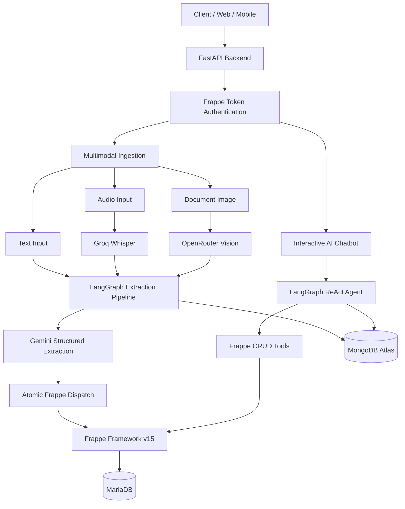

<div align="center">

# 🧠 WellPro Co-Pilot
### AI-Powered Personal Health, Wealth & Wellbeing Management

**A multimodal, agentic AI backend that transforms everyday conversations, voice recordings, and documents into structured personal data.**

Built with **FastAPI · LangGraph · Gemini · Frappe · MongoDB**


**[Overview](#-overview) · [Features](#-key-features) · [Architecture](#-system-architecture) · [API](#-api-reference) · [Getting Started](#-getting-started)**

</div>

---

## 📖 Overview

**WellPro Co-Pilot** is an AI-powered personal tracking backend designed to make health, finance, fitness, social activity, and wellbeing management effortless.

Instead of filling out forms, users simply **write, speak, upload documents, or chat with an AI assistant**.

The system understands natural language, extracts meaningful information, and automatically creates structured records in **Frappe ERP**.

It also features a persistent, multi-turn AI chatbot capable of performing **Create, Read, Update, and Delete (CRUD)** operations through natural language.

### 💡 Example

**User Input:**

> "I ran 5 km this morning in 30 minutes, spent $15 on lunch, and slept 7 hours last night."

**AI Processing:**

```text
Natural Language Input
         │
         ▼
    Gemini AI
         │
         ▼
 Structured Extraction
         │
         ├── 🏃 Health Activity
         │     ├── Running
         │     ├── Distance: 5 km
         │     └── Duration: 30 min
         │
         ├── 💰 Financial Transaction
         │     ├── Type: Expense
         │     └── Amount: $15
         │
         └── ❤️ Health Daily Record
               └── Sleep: 7 hours
         │
         ▼
   Atomic Frappe Dispatch
         │
         ▼
      MariaDB
```

**One input. Multiple structured records. Zero manual data entry.**

---

## 🎯 Project Goals

- **Simplify Personal Tracking:** Replace complex forms with natural language interactions.
- **Enable Multimodal AI:** Process text, multilingual speech, and document images.
- **Automate Data Management:** Convert unstructured inputs into validated Frappe records.
- **Provide Agentic AI Assistance:** Enable conversational CRUD operations through AI tools.
- **Maintain Persistent Memory:** Support context-aware, multi-turn conversations.
- **Ensure Multi-User Security:** Enforce Frappe permissions and isolate user conversations.
- **Optimize Performance:** Minimize AI inference overhead and database transaction contention.

---

## ✨ Key Features

### 📝 1. Intelligent Text Ingestion

Extracts structured information from unstructured notes using **Google Gemini** and **LangGraph**.

- Multi-domain extraction from a single input
- Structured JSON schema validation
- Automatic relevance classification
- Atomic record insertion into Frappe

### 🎙️ 2. Multilingual Voice Ingestion

Converts voice recordings into actionable records.

- Powered by **Groq Whisper Large V3**
- Supports multilingual speech
- Automatic English translation
- AI-powered structured extraction

**Supported formats:** `.mp3`, `.m4a`, `.wav`, `.ogg`, `.flac`, `.webm`

### 📄 3. AI-Powered Document OCR

Extracts structured information from receipts, bills, medical documents, and other images.

- Powered by **OpenRouter Vision API**
- Vision model: `meta-llama/llama-3.2-11b-vision-instruct:free`
- OCR text extraction
- Automated financial and health record creation

**Supported formats:** `.jpg`, `.jpeg`, `.png`, `.webp`

### 🤖 4. Agentic AI Chatbot

A conversational assistant powered by a **LangGraph ReAct agent**.

Users can interact with their records naturally:

> "Show me my expenses this month."

> "Update yesterday's running distance to 6 km."

> "Delete my last grocery expense."

> "How many steps did I walk this week?"

The agent automatically selects and executes the appropriate Frappe tools.

### 🧠 5. Persistent Conversation Memory

- MongoDB-backed LangGraph checkpoints
- Multi-turn conversational context
- Independent conversation sessions
- Chat history retrieval
- Session clearing
- User-level context isolation

### 🔐 6. Secure Multi-User Architecture

Every API request is authenticated using Frappe API credentials.

Conversation threads are isolated using:

```text
user_email:session_id
```

All CRUD operations execute using the authenticated user's Frappe token, preserving Frappe's permission boundaries.

---

## 🏗️ System Architecture

WellPro Co-Pilot follows a modular, service-oriented architecture.



### Architecture Components

| Layer | Technology | Responsibility |
|-------|------------|----------------|
| API Layer | FastAPI | REST endpoints and request validation |
| Authentication | Frappe Token Auth | User identity and authorization |
| AI Orchestration | LangChain + LangGraph | Extraction workflows and agents |
| LLM | Gemini Flash Lite | Structured extraction and conversational AI |
| Speech Processing | Groq Whisper | Multilingual speech-to-text |
| Document Processing | OpenRouter Vision | Image OCR |
| Business Layer | Frappe v15 | CRUD operations and business validation |
| Primary Database | MariaDB | Structured personal records |
| Persistence | MongoDB Atlas | Audit logs and conversation memory |
| Deployment | Docker + Gunicorn | Containerized backend execution |

---

## 🛠️ Technology Stack

| Category | Technology |
|----------|------------|
| Language | Python |
| API Framework | FastAPI |
| ASGI Server | Uvicorn / Gunicorn |
| Agent Framework | LangGraph |
| LLM Integration | LangChain |
| AI Model | Gemini Flash Lite |
| Speech-to-Text | Groq Whisper Large V3 |
| Vision / OCR | OpenRouter Vision |
| Business Backend | Frappe Framework v15 |
| Relational Database | MariaDB |
| Cache | Redis |
| NoSQL Database | MongoDB Atlas |
| Containerization | Docker & Docker Compose |
| Development | Ubuntu / WSL2 |

---

## 🌐 API Reference

**Base URL:**

```text
http://localhost:8080/api/v1
```

All endpoints require:

```http
Authorization: token <frappe_api_key>:<frappe_api_secret>
```

### 📥 Multimodal Ingestion APIs

| Method | Endpoint | Description |
|--------|----------|-------------|
| `POST` | `/ingest/process-text` | Extract structured records from text |
| `POST` | `/ingest/process-audio` | Transcribe multilingual audio and extract records |
| `POST` | `/ingest/process-image` | OCR document images and extract records |

#### Text Ingestion

```http
POST /api/v1/ingest/process-text
```

```json
{
  "raw_text": "I walked 10000 steps today and spent $20 on lunch."
}
```

#### Audio Ingestion

```http
POST /api/v1/ingest/process-audio
Content-Type: multipart/form-data
```

```text
file: <audio_file>
```

#### Document OCR

```http
POST /api/v1/ingest/process-image
Content-Type: multipart/form-data
```

```text
file: <image_file>
```

### 💬 Interactive Chatbot APIs

| Method | Endpoint | Description |
|--------|----------|-------------|
| `POST` | `/chat/message` | Send messages and execute AI-powered CRUD operations |
| `GET` | `/chat/history` | Retrieve persistent conversation history |
| `DELETE` | `/chat/clear` | Clear a conversation session |

#### Send Message

```http
POST /api/v1/chat/message
```

```json
{
  "message": "How much did I spend on groceries this month?",
  "session_id": "default"
}
```

**Example Response:**

```json
{
  "status": "success",
  "user_email": "user@example.com",
  "session_id": "default",
  "response": "You spent $245.50 on groceries this month."
}
```

#### Retrieve Chat History

```http
GET /api/v1/chat/history?session_id=default
```

#### Clear Chat Session

```http
DELETE /api/v1/chat/clear?session_id=default
```

### 📚 Interactive API Documentation

FastAPI automatically provides interactive API documentation:

**Swagger UI**

```text
http://localhost:8080/docs
```

**ReDoc**

```text
http://localhost:8080/redoc
```

---

## 🗂️ Supported Data Domains

The AI can extract and manage records across the following Frappe DocTypes.

| Domain | Frappe DocType | Tracked Information |
|--------|---------------|---------------------|
| ❤️ Health | `Health Daily Record` | Sleep, steps, hydration, calories, energy |
| 🏃 Fitness | `Health Activity` | Running, gym, duration, distance, intensity |
| 💰 Finance | `Financial Transaction` | Income, expenses, categories, merchants |
| 📊 Wealth | `Financial Snapshot` | Savings, investments, income, debt |
| 👥 Social | `Social Activity` | Calls, meetings, relationships, interaction quality |
| 🧘 Wellbeing | `Subjective Wellbeing Checkin` | Mood, stress, energy, loneliness, social connection |

---

## ⚡ Performance & Engineering Optimizations

WellPro Co-Pilot incorporates several backend optimizations focused on reducing latency and improving reliability.

### 🚀 Singleton Gemini Extraction Pipeline

The LangGraph extraction chain is compiled once and reused across requests.

**Implementation:** `app/services/gemini_service.py`

Benefits:

- Eliminates repeated LLM wrapper initialization
- Reduces schema parsing overhead
- Reuses HTTP connection pools
- Improves request throughput

### ⚡ Native JSON Schema Extraction

Gemini is configured with:

```python
method="json_schema"
thinking_budget=0
```

This avoids unnecessary function-calling validation loops and enables efficient structured output.

**Reported extraction latency:**

| Before Optimization | After Optimization |
|--------------------|--------------------|
| 20+ seconds | ~1.5–2.0 seconds |

> Performance figures represent observed extraction-stage latency, not guaranteed end-to-end API response times.

### 🔄 Atomic Frappe Batch Dispatch

**Implementation:** `app/services/frappe_dispatch.py`

Multiple extracted records are submitted through a single atomic transaction.

```json
{
  "atomic": true,
  "records": [
    {
      "doctype": "Health Activity",
      "record_data": {}
    },
    {
      "doctype": "Financial Transaction",
      "record_data": {}
    }
  ]
}
```

This reduces transaction overhead and mitigates MariaDB `tabSeries` lock contention.

### 🧠 MongoDB Conversation Checkpointing

LangGraph uses `MongoDBSaver` to persist conversation state.

```text
MongoDB Atlas
    │
    ├── Ingestion Audit Logs
    ├── chat_checkpoints
    └── chat_writes
```

Each conversation is isolated by:

```text
user_email:session_id
```

---

## 📂 Project Structure

```text
Well-Pro-Co-Pilot-AI-Backend/
│
├── app/
│   │
│   ├── api/
│   │   ├── v1/
│   │   │   ├── endpoints/
│   │   │   │   ├── chat.py
│   │   │   │   └── ingest.py
│   │   │   │
│   │   │   └── router.py
│   │   │
│   │   └── deps.py
│   │
│   ├── core/
│   │   ├── config.py
│   │   └── database.py
│   │
│   ├── schemas/
│   │   ├── auth.py
│   │   └── extraction.py
│   │
│   ├── services/
│   │   ├── chatbot_service.py
│   │   ├── frappe_dispatch.py
│   │   ├── gemini_service.py
│   │   ├── graph_service.py
│   │   ├── mongo_service.py
│   │   ├── openrouter_service.py
│   │   └── whisper_service.py
│   │
│   ├── tools/
│   │   └── ...
│   │
│   └── main.py
│
├── .dockerignore
├── .env
├── .gitignore
├── docker-compose.yml
├── Dockerfile
├── gunicorn_conf.py
├── requirements.txt
│
└── README.md
```

### Key Modules

| Module | Responsibility |
|--------|----------------|
| `chat.py` | Chatbot API endpoints |
| `ingest.py` | Multimodal ingestion endpoints |
| `deps.py` | Authentication dependencies |
| `config.py` | Environment and application settings |
| `gemini_service.py` | Structured AI extraction |
| `graph_service.py` | LangGraph ingestion workflow |
| `chatbot_service.py` | Stateful conversational AI agent |
| `frappe_dispatch.py` | Atomic Frappe record dispatch |
| `mongo_service.py` | MongoDB integration |
| `whisper_service.py` | Multilingual audio transcription |
| `openrouter_service.py` | Document image OCR |
| `tools/` | Frappe CRUD and dashboard tools |

---

## 🚀 Getting Started

### Prerequisites

Ensure the following are available:

- Python 3.x
- Frappe Framework v15
- MariaDB and Redis
- MongoDB Atlas connection
- Google Gemini API key
- Groq API key
- OpenRouter API key
- Docker (optional)

### 1. Clone the Repository

```bash
git clone <repository-url>

cd Well-Pro-Co-Pilot-AI-Backend
```

### 2. Create a Virtual Environment

```bash
python3 -m venv .venv

source .venv/bin/activate
```

**Windows:**

```powershell
.venv\Scripts\activate
```

### 3. Install Dependencies

```bash
pip install -r requirements.txt
```

### 4. Configure Environment Variables

Create a `.env` file in the project root.

Example configuration:

```env
# Frappe
FRAPPE_BASE_URL=http://localhost:8000

# Google Gemini
GOOGLE_API_KEY=your_google_api_key

# Groq Whisper
GROQ_API_KEY=your_groq_api_key

# OpenRouter Vision
OPENROUTER_API_KEY=your_openrouter_api_key

# MongoDB Atlas
MONGODB_URI=your_mongodb_connection_string
```

> Environment variable names are illustrative. Match them to the configuration defined in `app/core/config.py`.

**Never commit your `.env` file or API credentials to Git.**

### 5. Start Frappe

Ensure your Frappe Bench is running.

```bash
cd <frappe-bench-directory>

bench start
```

Expected Frappe URL:

```text
http://localhost:8000
```

### 6. Start the FastAPI Backend

From the project root:

```bash
uvicorn app.main:app --host 0.0.0.0 --port 8080 --reload
```

The API will be available at:

```text
http://localhost:8080
```

### 7. Open API Documentation

```text
http://localhost:8080/docs
```

---

## 🐳 Docker Support

The project includes Docker configuration for containerized deployment.

```text
Dockerfile
docker-compose.yml
gunicorn_conf.py
```

### Build and Start

```bash
docker compose up --build -d
```

### View Logs

```bash
docker compose logs -f
```

### Stop Containers

```bash
docker compose down
```

> Ensure external dependencies, environment variables, and Frappe connectivity are configured according to your Docker Compose setup.

---

## 🔐 Security & Data Isolation

Security is enforced through the following mechanisms:

- **Token Authentication:** Every request requires valid Frappe API credentials.
- **User-Level Authorization:** CRUD operations use the caller's verified token.
- **Conversation Isolation:** MongoDB threads are namespaced by user email and session ID.
- **Structured Validation:** Extracted records are validated against defined schemas.
- **Atomic Transactions:** Multi-record operations use transactional dispatch.
- **Audit Logging:** Ingestion events and processing results are persisted in MongoDB.

---

## 🔮 Future Enhancements

Potential improvements include:

- Real-time streaming chatbot responses
- Advanced analytics and personalized insights
- Intelligent financial and health recommendations
- Automated duplicate detection
- Conversation management and pagination
- Background processing for large audio and image files
- Observability dashboards and distributed tracing
- Automated AI extraction evaluation and regression testing

---

## 📌 Project Status

**Current Stage:** Backend implementation with multimodal ingestion and interactive AI chatbot capabilities.

### Implemented Components

- ✅ FastAPI REST backend
- ✅ Frappe v15 integration
- ✅ Secure Frappe token authentication
- ✅ Text ingestion with Gemini
- ✅ Multilingual voice ingestion with Groq Whisper
- ✅ Document OCR with OpenRouter Vision
- ✅ LangGraph structured extraction pipeline
- ✅ Atomic multi-domain Frappe dispatch
- ✅ MongoDB ingestion audit logging
- ✅ LangGraph ReAct chatbot
- ✅ AI-powered CRUD tools
- ✅ Persistent multi-turn conversation memory
- ✅ User-isolated conversation sessions
- ✅ Chat history and session management
- ✅ Docker configuration

---

## 📄 License

License information has not yet been specified.

---

<div align="center">

### 🧠 WellPro Co-Pilot

**Turning everyday language into intelligent, structured personal insights.**

Built with FastAPI, LangGraph, Gemini, Frappe, and MongoDB.

</div>